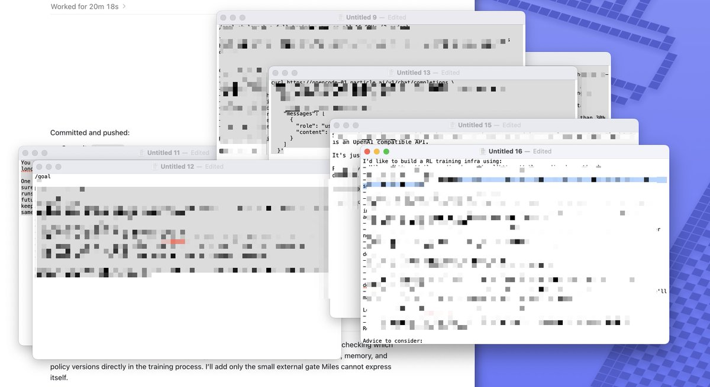
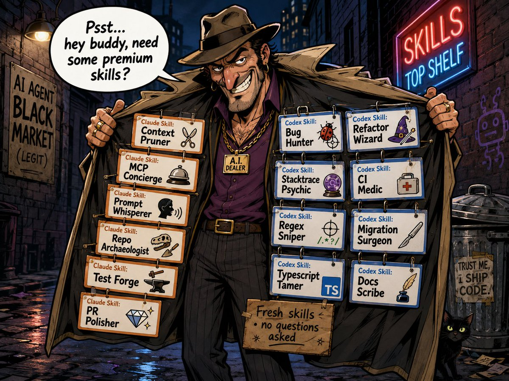

I had an interesting last couple of weeks.

I am on an India trip. I went to Bangalore for a week, without knowing a series of AI/startup events called "Basecamp" was happening - but it was a great coincidence, met a lot of old and older friends. Got to interact with a lot of students, at Scaler School of Technology, and then at IIT Gandhinagar. Finally got to re-connect with folks from my first startup and friends from university and Zomato days at Delhi.

In some of these settings (few of my friends are CTOs/founders/engineering leaders at various companies and wanted me to interact with their teams too; and then I got to take some lectures with the kids at the two universities) I got to see how those who are onboarding the the world of tech and software directly in a post agentic-AI world are operating.

And I also heard stories on how people are coping with a) everyone getting AI psychosis, b) everyone grappling with identity issues and imposter syndrome and c) how AI usage is causing chaos of all sorts at work.

Now I am neither an ML researcher who has built LLM models nor any coding harness creator of repute, but I think l have done more than my fair share of tinkering with all of them to have an idea what works and what doesn’t than your average AI-slinging Joe.

The one thing that struck me (well many things did, but the one I wanted to talk about at least here) about how people are using these tools is that, almost everyone seemed to be doing the monkey with a gun routine

> the meme probably does not even do enough justice because at least the monkey doesn't comment on how the gun is not powerful enough or doesn't have enough bullets in 5hr and 5 day windows.... 🥲

## coding is solved, prompt engineering is not

there is this famous saying (within the halls of bigtech or alleys of stack overflow where people asked the difference between senior and junior engineers)

- **Junior Engineer** — creates **complex solutions to simple problems**

- **Engineer** — creates **simple solutions to simple problems**

- **Senior Engineer** — creates **simple solutions to complex problems**

the funny thing about software is, the more you understand the problem, the simpler a solution you can come up with. the less you can describe the problem, the more complex the solution is. and thus, as Boris and Dario keep saying, coding is solved, but what has not been solved is people being able to describe exactly what they want, and in fact, because models like Opus and Sol love to jump to conclusions and complete your thoughts - people have gotten more and more addicted to dump half formed thoughts into their ai agents. the advent of the culture of rambling into voice mode is yet another symptom of this.

## all this “context engineering” and yet...

there was this time in 2017-19 era when infrastructure-as-code was at its peak hype+growth to the point that "YAML Engineer" became not just a meme but a reality

> One of my clients took me seriously and is hiring a Senior YAML engineer.
>
> I'm not kidding.
>
> Come help right my wrongs.
>
> [jobs.lever.co/scribd/503a16d…](https://jobs.lever.co/scribd/503a16da-a319-42f6-9c73-ee2a6e51d331)
>
> [Corey Quinn (@QuinnyPig)](https://x.com/QuinnyPig/status/1174084162770198529)

the entire discourse about “prompt engineering”, and then “context engineering” mostly cringes me out, and I always thought what is there to learn here? this all seems mostly common sense (as in, the art of prompting the model, or later, the art of making sure the model has all the context it needs to do a task)

but that said, the thing that inspired the title image of this post was seeing so many people’s coding setup not much different from this what would be the equivalent of a chef’s setup if it looked like this

> prompting Fable 5 to change 1 string and it failing and you thinking you need a 'smarter' model is maybe because Fable's context window looks like this when you give it a task

I have lost count of the number of people to whom I gave these following tips, which they received like some gospel that they have never heard before

1.  model performance drops with context length (from barely noticeable at 75k tokens to visibly unfocussed/ineffective at \>200k tokens)

2.  model gives most attention to system prompt and most recent part of prompt; things in the middle lose importance

3.  any task that is too big to hit a compaction window should have been split up even before starting (manually splitting up tasks is not required, a sub-agent workflow can do it too, but a single session should ideally wrap up before it hits compaction)

an alarmingly large number of people have been running claude/codex sessions for “WEEKS!!”, across “THOUSANDS!!” of messages. the chat thread has turned so long it can be weaved into an entire garment at this point. it has encountered more than a dozen compaction windows. all because the model just keeps working even if you keep doing this, and the tools never nudge you out of this behaviour

obviously when your context is so full of crap, you are needing Fable class models to somehow accomplish tasks that would be demolished by Haiku in a fresh empty context

## skill issue

i don’t want to single Suhail out, but just picking this example because a) I just saw it today, and b) he is one of the best tech founders of our generation, and he is the 10th or 15th person I’ve seen doing some version of this

> This is my desktop now.
>
> I have 7 random text edits holding prompts for my agents for different situations. Surely, this is not the future and a sign of how early it is.
>
> 
>
> [Suhail (@Suhail)](https://x.com/Suhail/status/2091661421327396970?s=20)

if you use the same prompt really very often, you save it as a skill (or command - if your coding harness has distinction between commands and skills)

but on the extreme other end of the problem, and I kid you not, I found people with over 300 skills installed. and while there is progressive discovery and what not to “mitigate” the problem, but it absolutely does bloat the context. in some coding agents the title/description of every skill goes into the system prompt, and even in the ones where there is “skill discovery” built in - the model often finds multiple conflicting skills and doesn’t know what to use

> from ponytail to gstack to a bunch of other random-ass skills that people keep installing, most of which are counter productive, and should not even be global skills, and makes their agent even more retarded

all of it is downstream of a big crop of "skill merchants" who have cropped up. lot of erstwhile PMs and DevRels who have sort-of semi-FIREd and do not need serious work themselves, are into building mindless software factories, but because of their existing fan following and distribution, keep making social media posts and videos about "if you just use this skill I made your life will be solved" and people following them like their messiah

> a whole army of skill-selling pied pipers have cropped up like mushrooms over there on linkedin. it is a plague. and anthropic/openai have zero pushback because it only keeps pushing up demand, i guess

and despite all of this, i keep getting surprised when I tell people these things and they make a face like they are hearing this for the first time

1.  skills do not need to have the entire content in SKILL.md file, you can split out deeper references into further md files so that the model can progressively “learn” your skill during a task

2.  the entire spec of how skills are to be made is available on

    [agentskills.io](https://agentskills.io)

3.  skills can (should) have scripts (js/py) in them, where the deterministic part of the skill should be encapsulated. do not write “code snippets” as examples in SKILL.md, just write a companion script.js instead. do not make code “copy paste through the LLM” - it is an inefficient use of GPU cycles

4.  most skills should be project specific and not global. things like how to use ios simulator is useful in ios projects, why make it global unless 90% of projects you work on are ios apps

---

anyway, I think i’ll try to start wrapping up my rant. I just am mostly very dissappointed, that these immensely powerful tools are getting used in such ineffective ways, just because the tools make it so easy to use them in any which way - so everyone is being lazy with learning how to use them properly

and not surprisingly, in my interactions one consistent thing was that those who seemed to complain the most about Fable or Sol being dumb or how the models are not good enough for them, or how they keep hitting \$200 plan limits all the time - are the ones who are building the least number of actually interesting things (or even anything at all.

meanwhile I found people solving some real serious problems across recruiting, automating filling forms for admin work, gathering leads for offline sales, automating design for ads for small businesses - all heaping tons of praise on models like grok 4.5/4.6 and gemini 3.7 flash for being fast and effective, having nothing to complain about \$200 plan limits, or any complaints about models being dumb or anything - they are turning every dollar of ai token spends into multiple more dollars of actual business revenues.

i have more rants about the false choice between “read code vs don’t read code”, and the [meat proxy](https://gruhn.me/blog/2026-08-03/) issue almost everyone I talked to in mid to large companies seemed to be facing, but that’s for later.
