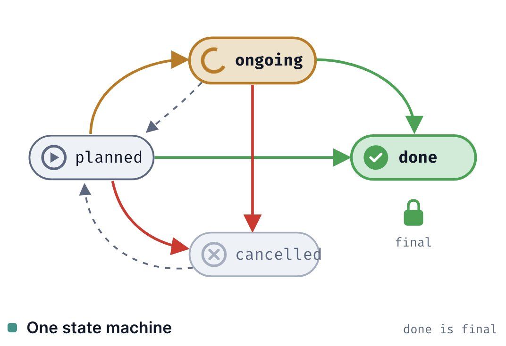
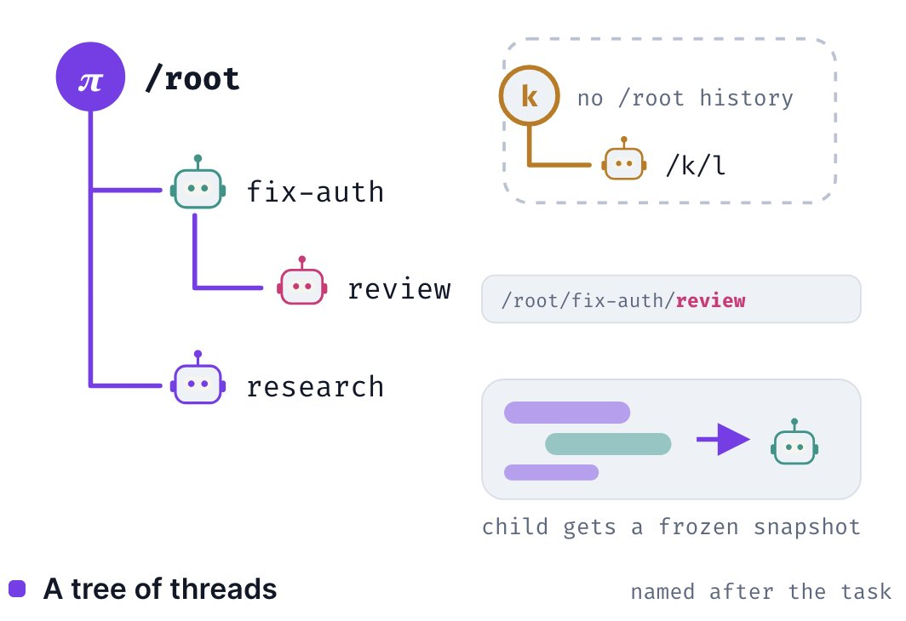
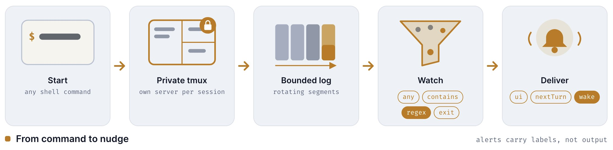
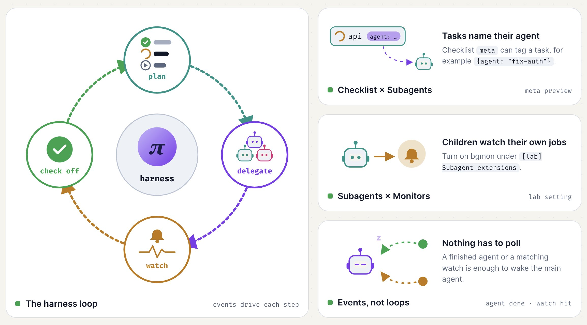

I [wrote](https://x.com/championswimmer/status/2107883453811233185) a while back about how I wrote my own pi extension for managing subagents. This one is about 2 more things: checklists and monitors.

> for those who have lost the ability to read beyond tweet sized things a) I can sympathise, I am sorry for you, but I can understand, and b) you can [see this visual guide](https://sites.arnavg.in/learning/pi-harness-ingredients/) instead of reading all this

Once again, I am going to repeat myself on why exactly I use Pi, and not just use Claude or Codex which has these features I am talking about, instead of putting in the pain to develop these. Mostly because I really like the extensibility. Every time I come across a quirk, a small defficiency, a certain way I do not like Claude or Codex have implemented a feature, I just cannot go ahead and change it. (Codex is even open source, but come on who is going to run their own fork of a tool that is changing at a rate of few hundreds commits a day lol). Pi on the other hand is extremely minimal at its core, and you can setup whatever extensions you like. I even [gave a talk recently](https://arnav.tech/slides/build-your-own-coding-harness/) on exactly why this architecture is so useful to extend it

I think Anthropic and Google are wrong about "model working best in native harness". I regularly use Claude, GPT and Gemini models in Pi (in enterprise plans you can use it, unlike on consumer subscriptions), and they work absolutely perfect with Pi as a harness, might I say they are often faster/cheaper at the same task on Pi because of smaller context and simpler setup. (There are [benchmarks](https://huggingface.co/spaces/joelniklaus/harness-leaderboard) on harnesses if you want more objective proof).

Instead I think [@badlogicgames](https://x.com/badlogicgames) and [@mitsuhiko](https://x.com/mitsuhiko) and the folks at [@pidotdev](https://x.com/pidotdev) are right that everyone needs to modify their harness to their own needs so that harness needs to have hooks at every lifecycle event and a modifiable 'harness context' that extensions can edit (a brilliant design! i think we do appreciate often enough how good it is). I think a harness needs to have a very reliable, simple (however loaded that term is), minimal core so that the core doesn't have to be opinionated about too many things - that is where the extensions come in.

There are probably a bunch of good ways to implement subagents. As I noted in my previous article, where I described how and why I made my pi-subagent-manager extension; I used the ones made by [@nicopreme](https://x.com/nicopreme) and [@nicht_tintin](https://x.com/nicht_tintin) both a lot before making me own. Their implementations are pretty good, I just wanted a couple of my own twists there (like path based naming convention, some cute icons and animations too!). The whole point of Pi is that you can set it up exactly the way you want it to.

- Do you want subagents to use a different model?
- Do you want the main model to chose the model for the subagent on the fly or do you want them fixed for each agent?
- Do you want all subagents to be the same, or define different system prompts and have different "agent types"?

All great questions with perfectly valid different answers.

What is not a question is "do we want to use subagents?" I think that is a clear **yes** in 2026. Especially when you can do things like use Opus 5.5 as an orchestrator to get the best thinking mind available an then use a cheap and fast as hell model like DeepSeek 4.1 Flash to just go and destroy the task list created by Opus in seconds for pennies.

Apart from subagents, I think we do have a few more patterns, that are starting to coalsce inside the mainstream harnesses (antigravity, codex, claude), that have become the staple tools/patterns in a coding harness without which your harness will not be complete.

1. **monitors**: a way for your the coding agent to start a 'shell' (say a tmux window, in fact in Claude it *is* tmux), and then monitor it periodically for certain keywords/regexes in the output. There are often scripts, builds, log monitoring that your agent has to run, and it is important that; **a)** the entire output doesn't pollute the context window when we only want to watch for a certain thing, and **b)** running and watching this shell can be done separately from the main thread which is running the LLM API inference loop.
2. **checklists**: over a longer horizon of tasks, models can actually be quite forgetgul. when the model initially plans the tasks it wants to do, it pretty coherently has a *plan* in mind. it knows what steps need to be done, in what order, and which steps are blocked on which. just like humans, putting that all up on a ~~JIRA~~ Linear like place (just basic ass project management) is great, so that when you deploy a swarm of coding agents (human or AI) at it, they do not step over each others work. and if you do not provide the harness with a specific tool for this, then then they just go ahead and use tmp markdown/txt files to do this you'll notice
3. **subagent manager:** as already covered in the previous article, the harness needs to have a canonical mechanism of starting, observing, stopping, orchestrating the subagents (and not by shelling out and starting new copies of the harness, but within the same session).

*the checklist provides the state machine of the entire work*

*the subagents let you split up the work and let separate agents focus on each area without a bloated context for everything*

*monitors let you run long running deterministic things in the background which should not be in the inference loop to begin with*

Now, I think each of these 3 things, individually are itself great tools and great patterns, and without the other two, in their own merit are things worth considering. I cannot imagine working without any of these three things. I need even my single-threaded agent to use **checklists.** I often want to use **subagents** to do work, and models like Opus, Carbon, Sol are really smart at distributing work to their smaller siblings like Sonnet and Terra. And **monitors** are an absolute must have in sessions where I want to agent to set a watch on a long running build job that emits thousands of lines of logs etc.

But... when put together, these 3 things literally make for the most important building blocks for the modern coding harness. A coding harness which has subagents, checklist, and monitors is literally a whole different thing from a basic harness that just has the inference loop and tools. Most modern models will actually yearn for these tools because they are already trained to use these shapes. They will write out task lists in text files. They will spawn up new instances of the cli to subagent-ify their work. They will run weirdass shell/python scripts to run commands and grep for their outputs. Instead it is best to just give them first-class tools that provide these things.

*when put all together, this is an upgrade of the coding harness to a new generation, very different from early 2026 era harness that only loops and calls tools*

I'll end this again by saying, you should probably design your own tools for all these three things. As I have. I am linking my extensions below (some, like the *pi-subagent-manager* have in fact lately become quite popular, but the main reason they are on npm is because it is convinient for me to install it on multiple machines, pin their versions, and share with my coworkers). Feel free to use them, as it is, or fork and make your own tweaks.

- [pi-subagent-manager](https://www.npmjs.com/package/pi-subagent-manager)
- [pi-checklist](https://www.npmjs.com/package/pi-checklist)
- [pi-background-monitor](https://www.npmjs.com/package/pi-background-monitor)

There are a couple of special tweaks I have in my subagent manager to play nice with the other two, for example, it uses the *meta* field of checklist to mark which task is being done by which agent. But you can each of these 3 independently of the other 2 as well.
